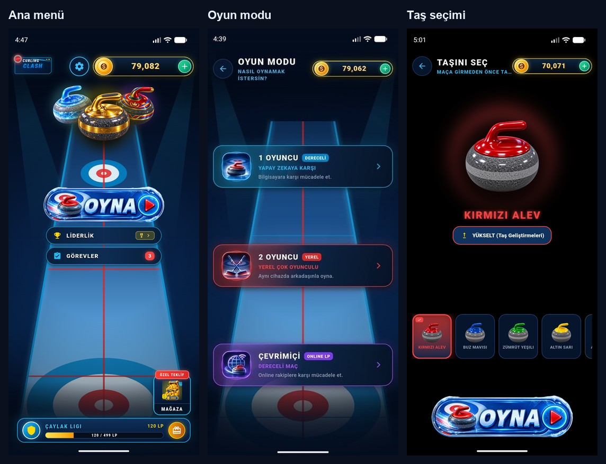
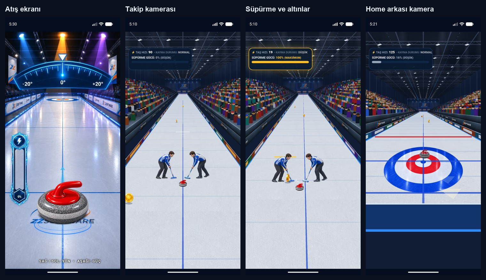
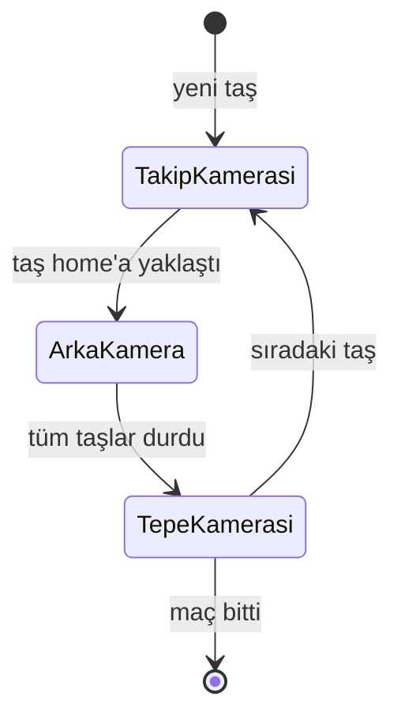
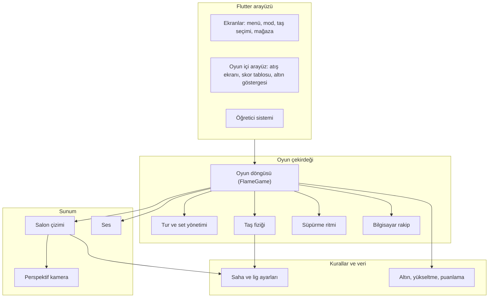
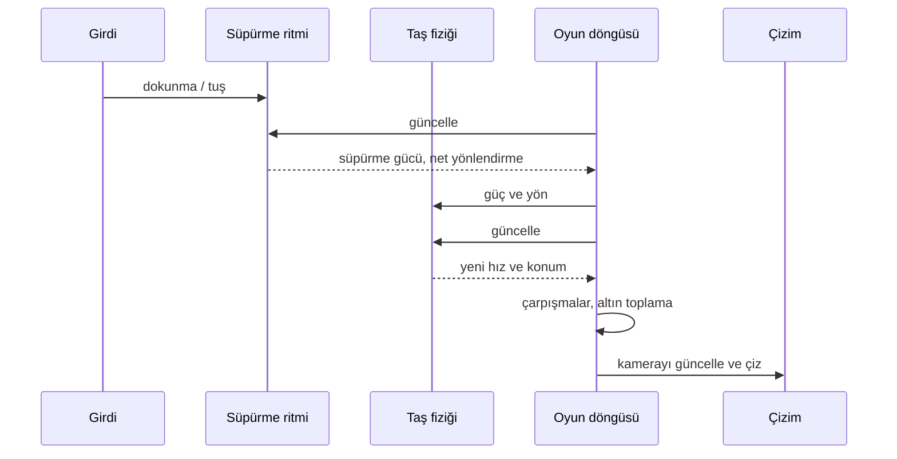
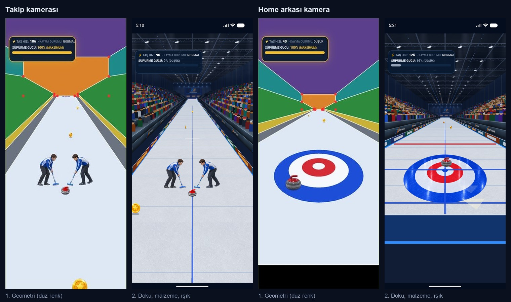
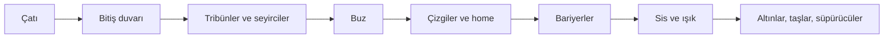
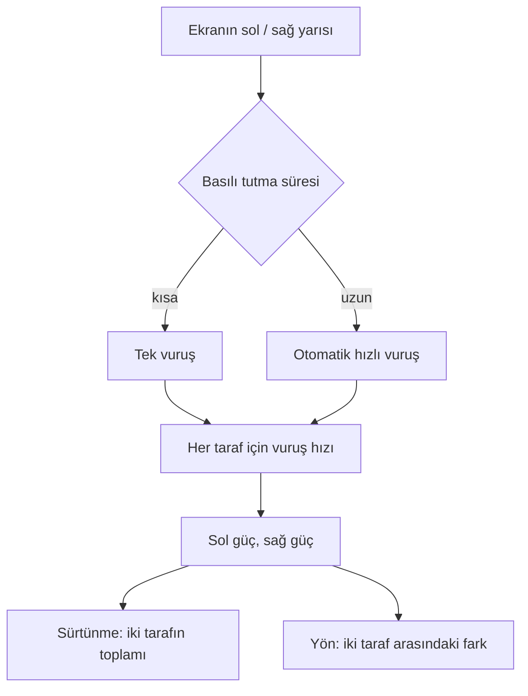

# Curling Clash — Proje Tanıtımı

> **Bu depo bir tanıtımdır.** Oyunun kaynak kodu, görselleri ve sesleri özel bir
> depoda tutulur; burada yalnızca projenin mimarisi, teknik yaklaşımı ve ekran
> görüntüleri yer alır. Kod incelemesi için erişim talep üzerine verilir.

Curling Clash, Flutter ve Flame ile geliştirilmiş, dikey ekran mobil bir curling
oyunudur. Taş tek bir fizik dünyasında kayar; aynı dünya, hazır bir 3B motor
kullanılmadan yazılmış perspektif kamera sistemiyle üç farklı yayın açısından
çizilir.



## Öne çıkanlar

| | |
|---|---|
| **Kendi 3B çizim hattı** | Salonun tamamı (buz, bariyerler, 11 basamaklı tribünler, çatı makasları, duvarlar) Flutter `Canvas` üzerinde, elle yazılmış bir iğne deliği kamerayla projekte edilir. Hazır 3B motor yoktur. |
| **Tek dünya, tek fizik, üç kamera** | Takip kamerası, home arkası kamera ve tepe görünümü aynı dünya koordinatlarını okur. Kamera değişince hiçbir nesne yeniden oluşturulmaz. |
| **Fizik ile sunumun ayrılması** | Fizik yazar, çizim yalnızca okur. Çizim katmanı taş konumlarını hiçbir koşulda değiştirmez. |
| **Malzeme sistemi** | Çelik tribünler, dört ayrıntı seviyesinde önceden süzülmüş bir doku atlasından, dünya koordinatlı doku eşlemesiyle ve tribün başına tek çizim çağrısıyla çizilir. |
| **İki süpürücülü ritim kontrolü** | Ekranda düğme yoktur: ekranın iki yarısı iki süpürücüdür. Vuruş ritmi sürtünmeyi, iki taraf arasındaki fark taşın yönünü belirler. |
| **Prosedürel ses** | 23 ses efektinin tamamı kayıt kullanılmadan, sinüs bileşenleri ve süzülmüş gürültüden kodla üretilir. |
| **Tam oyun döngüsü** | Altın ekonomisi, taş yükseltmeleri, dört lig, günlük görevler, bilgisayar rakip, yerel iki oyunculu mod, adım adım öğretici ve Türkçe / İngilizce dil desteği. |

Ölçek: 135 Dart dosyası, yaklaşık 36.000 satır; çizim hattının çekirdeği tek
başına 2.600 satır. Kamera projeksiyonu, süpürme modeli, altın ve ekonomi
kuralları birim testleriyle doğrulanır.

## Oynanış



1. **Atış:** taş tutulur, aşağı çekilerek güç, yana kaydırılarak yön verilir ve bırakılır.
2. **Takip:** kamera taşın arkasından ilerler; salon akar, home uzaktan yaklaşır.
3. **Süpürme:** ekranın sol yarısı sol süpürücüyü, sağ yarısı sağ süpürücüyü çalıştırır. Yoldaki altınlar toplanır.
4. **Home:** taş home'a yaklaşınca yayın home arkası kameraya geçer; taşlar durunca sonuç tepeden gösterilir ve halkaya göre puan verilir.



## Mimari



Her karede sıra sabittir: girdi → süpürme ritmi → fizik → çarpışmalar ve altın
toplama → kamera → çizim.



## Çizim hattı

Salon iki aşamada kurulur. Önce geometri: her yüzey dünya koordinatlarında
tanımlanır ve kameradan projekte edilir. Düz renkli görünüm, yüzeylerin aynı
köşe noktalarında birleştiğini ve salonun kapalı bir hacim olduğunu doğrulamak
için kullanılır. Sonra aynı köşe noktalarının üstüne doku, malzeme, seyirci,
sis ve ışık gelir.



Kamera, optik ekseni yatay olan bir iğne deliği modelidir. Ufuk ekranda sabit
bir satırdır; her nesnenin boyutu yalnızca kameraya uzaklığından gelir:

```dart
Offset _at(double wx, double wz, double d) {
  final s = focal / d;                                   // piksel / dünya birimi
  final sx = screenCenterX - forwardSign * (wx - x) * s; // yön işareti kamerayı çevirir
  final sy = horizonY + (height - wz) * s;
  return Offset(sx, sy);
}
```

Teknik notlar:

- **Dokular dünyaya bağlıdır.** Doku koordinatları ekran konumundan değil dünya
  konumundan üretilir; kamera ilerlerken buz ve çelik deseni yerinde kalır.
- **Perspektif düzeltmesi.** Uzun yüzeyler derinlik boyunca şeritlere bölünür;
  şerit sınırları sabit bir dünya ızgarasına oturur, böylece aydınlatma
  kamerayla birlikte kaymaz.
- **Ayrıntı seviyeleri.** Çelik doku 1, 2, 4 ve 8 texellik ortalamalarla
  önceden süzülür; uzaktaki basamak zaten yumuşatılmış şeridi örnekler ve ince
  kenar parlaması titremek yerine sönümlenir.
- **Çizim sırası.** Derinlik tamponu yoktur; katmanlar uzaktan yakına sabit
  sırayla çizilir.



## Taş fiziği

Uzunluk birimi oyunun dünya birimidir (yaklaşık 290 birim = 1 metre).

**Sürtünme.** Taş sabit bir ivmeyle yavaşlar; yön korunur. Lig uzadıkça ivme
aynı oranda küçülür, böylece aynı atış gücü sahanın aynı oransal noktasına düşer.

```
a₀ = 280 / ligÇarpanı × (2,1 / 2,8)
v  ← v − a · dt
d  = v² / (2a)
```

**Süpürme.** Süpürme taşa hız eklemez, yalnızca hız kaybını azaltır. Taşın
yükseltme seviyesi (`u`) tam süpürmedeki kaybı daha da düşürür.

```
p = sınırla(0,6 · (p_sol + p_sağ) + 0,1 · min(p_sol, p_sağ), 0, 1)
f = 0,36 − 0,20 · u
a = a₀ · (1,45 + (f − 1,45) · p)
```

| Durum (1000 birim/s hız) | Çarpan | Kalan mesafe (birim) |
|---|---|---|
| Süpürme yok | 1,45 | 1 642 |
| Tam süpürme | 0,36 | 6 614 |
| Tam süpürme, tam yükseltme | 0,16 | 14 881 |

**Yönlendirme.** Süpürücüler arasındaki güç farkı taşı çevirir; hızın büyüklüğü
korunur ve yanal pay sınırlıdır.

```
yön = sınırla(0,22 · (p_sol − p_sağ) + doğrudanGirdi, −1, 1)
v_x ← sınırla(v_x + yön · 560 · dt, −0,42 · |v|, +0,42 · |v|)
```

**Çarpışma.** Taşlar eşit kütleli dairelerdir; itki çarpışma normali boyunca
uygulanır ve toplam momentum korunur.

```
J = (1 + e) · ((v₁ − v₂) · n) / 2        e = 0,92
v₁' = v₁ − J · n        v₂' = v₂ + J · n
```

## Süpürme kontrolü



Sol süpürücü taşı sağa, sağ süpürücü sola iter; iki taraf eşit süpürürse taş
düz gider ve en uzağa ulaşır. Süpürücüler bariyere dayandığında taş ortaya
doğru geri itilir ve kamera kısa bir sarsıntı verir.

## Ses

Her olayın kendi sesi vardır: taşı tutma, güç ve yön çentikleri, bırakma,
hıza bağlı kayma uğultusu, fırça vuruşları, tek altın ve çoklu altın, taş
çarpışması, puan, seyirci ve maç sonu. Sesler oynatıcı havuzlarından çalınır;
aynı anda birden çok ses birbirini kesmeden duyulur. Ses dosyalarını üreten
betik projenin parçasıdır, bu yüzden bütün ses seti tek komutla yeniden
üretilebilir veya ayarlanabilir.

## Ekonomi ve ilerleme

| Olay | Altın |
|---|---|
| Buzdaki altın | +5 |
| Dış halka / beyaz / kırmızı / merkez | +5 / +10 / +15 / +25 |
| Rakip taşı home'dan çıkarmak | taş başına +25 |
| Maçı kazanmak | +100 |
| Günlük görevler | +30 / +50 / +100 |

Kazanılan altınla taşların doğruluk ve süpürme etkisi yükseltilir, yeni taşlar
açılır. Lig yükseldikçe saha uzar ve bilgisayar rakip güçlenir.

## Teknoloji

- Flutter (Dart), Flame oyun döngüsü
- Çizim: `Canvas.drawVertices`, `ImageShader`, çalışma zamanında üretilen doku atlası
- Ses: havuzlu oynatıcılar, Python ile üretilen ses seti
- Hedefler: Android ve web

---

© ZZ Software. Tüm hakları saklıdır. Bu depodaki metin ve görseller yalnızca
tanıtım amacıyla paylaşılmıştır; kopyalanamaz, dağıtılamaz ve ticari amaçla
kullanılamaz.
